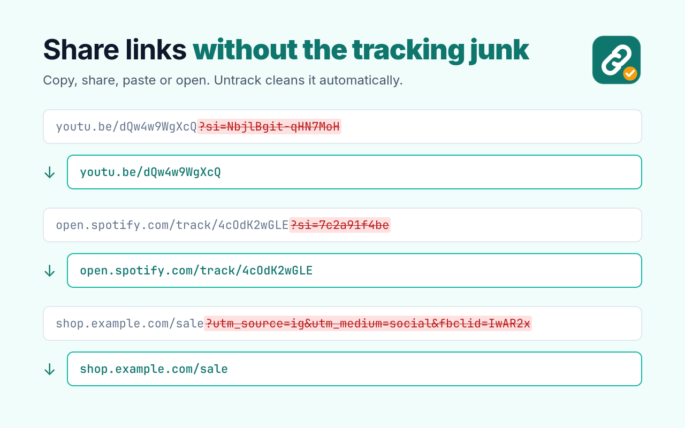
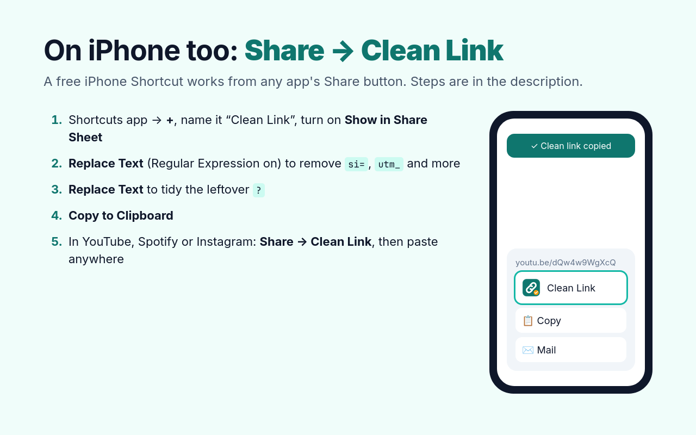

<p align="center"></p>

# Untrack

Removes tracking junk from links: the `?si=...` on YouTube and Spotify links, `utm_*`,
`fbclid`, `gclid`, X's `?s=20&t=...`, TikTok/Reddit/Amazon share IDs, and more.

Free and open source. No account, no data collected.



- [Install on a computer](#install-on-a-computer) (Chrome, Edge, Brave, Arc, Vivaldi, Opera)
- [iPhone](#iphone) (Share → Clean Link)
- [Android](#android) (Firefox)

## What it cleans

Nothing to click. Once it's installed, it just works:

| Where | How |
|---|---|
| **Anything you copy** | Ctrl+C, right-click → Copy, "Copy link address", and sites' own **Share → Copy link** buttons all put the clean link on your clipboard. Links inside a bigger chunk of copied text get cleaned too, and rich-text copies keep their formatting. |
| **Anything you paste** into a web page | Links copied from other apps (Discord, your phone's synced clipboard, ...) are cleaned as you paste them. |
| Links you open | Rewritten before the page loads |
| Address bar | Cleaned on load and on in-page navigation (YouTube, X, etc.), so copying from it is clean too |
| Links on pages | Link addresses are rewritten as the page loads |

Click the toolbar icon to pause it (badge shows **off**), and click again to turn it back on.

Generic names like `si`, `s`, `t`, and `ref` are only removed on the sites that use them for
tracking, so `?t=90` timestamps on YouTube keep working and other sites' `?s=` search
isn't broken.

## Install on a computer

1. Download [**untrack-chrome.zip**](https://github.com/9shrey/untrack/releases/latest/download/untrack-chrome.zip) (from [Releases](https://github.com/9shrey/untrack/releases/latest)).
2. Unzip it, and put the folder somewhere it can stay (for example Documents). Chrome loads
   it from there, so don't delete it.
3. Open `chrome://extensions` (in Edge: `edge://extensions`).
4. Turn on **Developer mode** (top right).
5. Click **Load unpacked** and pick the unzipped folder.

Works in any Chromium browser, version 111 or newer.

To update: download the new zip, replace the folder's contents, and click the ↻ reload
button on Untrack in `chrome://extensions`.

> Chrome may sometimes show a "developer mode extensions" notice. That's normal for
> extensions installed this way instead of from the Chrome Web Store. Click **Keep**, or just close it.

## iPhone

Chrome extensions don't run on phones, but an iPhone Shortcut does the same job from the
**Share** button in any app (YouTube, Spotify, Instagram, Safari...). It's free and needs no app.



Set it up once (about 2 minutes):

1. Open the **Shortcuts** app and tap **+** to make a new shortcut. Name it **Clean Link**.
2. Tap the ⓘ (or the name at the top) and turn on **Show in Share Sheet**. Keep **URLs** and
   **Text** as the input types.
3. Add the action **Replace Text**:
   - Find (copy this exactly):
     ```
     (?<=[?&])(si|utm_[a-z_]+|fbclid|gclid|igsh|igshid|feature|pp|mibextid|share_id|ref_src|ref_url|_r|_t|is_from_webapp|sender_device|srsltid)=[^&#]*&?
     ```
   - Replace with: leave empty
   - In: **Shortcut Input**
   - Tap **Show More** and turn on **Regular Expression**.
4. Add a second **Replace Text** action:
   - Find:
     ```
     [?&]+(?=#|$)
     ```
   - Replace with: leave empty
   - In: **Updated Text** (from the step above)
   - Turn on **Regular Expression**.
5. Add the action **Copy to Clipboard**.
6. (Optional) Add **Show Notification** with the text "Clean link copied".

To use it: in any app, tap **Share → Clean Link**, then paste anywhere.

If **Clean Link** isn't in the share menu, scroll to the end of the app row, tap **More**
and add it to Favorites.

## Android

Chrome for Android can't run extensions, but Firefox for Android can. The Firefox build
works the same way inside Firefox.

1. Build it with `./build-firefox.sh`, which makes `dist/untrack-firefox.zip`.
2. Firefox only installs signed add-ons. Signing is free: upload the zip at
   [addons.mozilla.org/developers](https://addons.mozilla.org/developers/addon/submit/distribution)
   and pick **On your own**. You get back a signed `.xpi`.
3. In Firefox for Android: **Settings → About Firefox**, tap the logo 5 times, then
   **Settings → Install add-on from file** and pick the `.xpi`.

To pause it, use **⋮ → Extensions → Untrack**.

**On phones:** links shared from **apps** (YouTube app, Spotify app) and Firefox's own
long-press **Copy link** menu never go through a web page, so they aren't cleaned when
copied. They are cleaned when you paste them into a page or open them in Firefox.

## Limits

A browser extension only sees what happens inside web pages. Copying in a desktop app
(Discord app, Telegram, a terminal) and pasting into another desktop app goes around it.

## Privacy

Untrack collects nothing and sends nothing anywhere. All cleaning happens on your device.

## For developers

The list of tracking parameters lives in [cleaner.js](cleaner.js). Add a name there and
every part of the extension picks it up.

```bash
node test.js          # cleaning rules
node ios-test.js      # iPhone Shortcut patterns
./build-chrome.sh     # dist/untrack-chrome.zip
./build-firefox.sh    # dist/untrack-firefox.zip
```

`store/listing.md` has ready-made Chrome Web Store text if you ever want to publish there
(Google charges a one-time $5 developer fee).

## License

MIT
